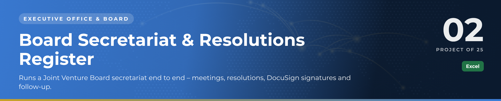
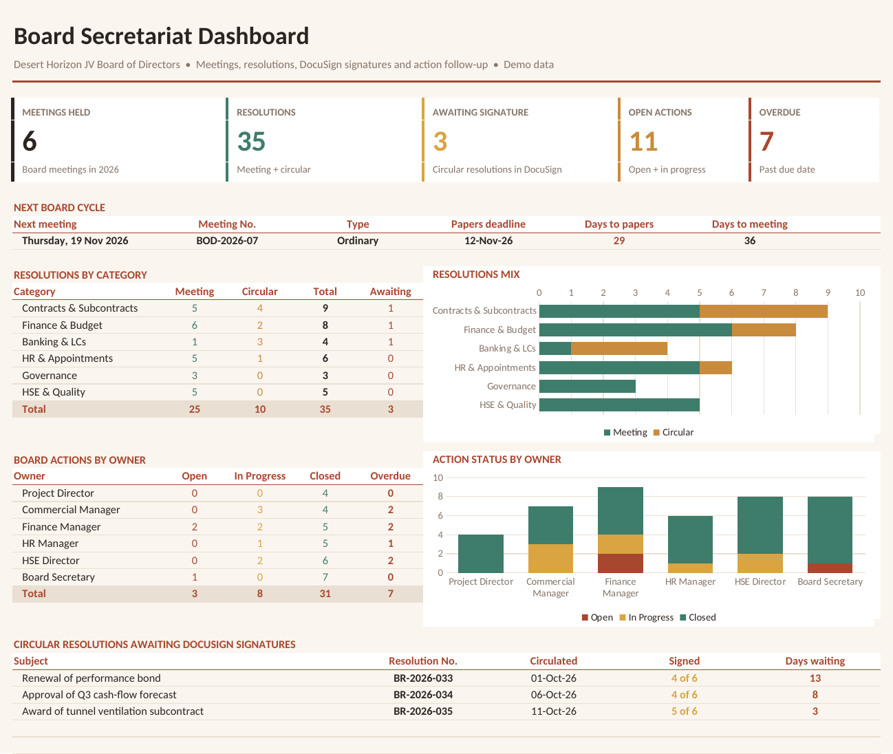

 

  

🏛️ <b>Executive Office & Board</b> · Project 02 of 25 · <a href="https://github.com/sudheer-ahmed-khattak/Excel-Trackers-and-Management-Reports">⬅ Back to all projects</a>

---

## 🎯 The Challenge

Board work is unforgiving: papers must go out on time, every resolution needs a clean number and full signatures, and actions agreed in the boardroom must not quietly die.

## ✅ The Solution

A board secretariat workbook with a live dashboard: meeting calendar with automatic papers deadlines, a numbered resolutions register, circular resolutions tracked through DocuSign, an action log with overdue alerts and an attendance matrix.

## 📦 What's Inside

| Sheet / Page | What it does |
|---|---|
| **Dashboard** | Next board cycle countdown, resolutions by category, actions by owner, signatures pending |
| **Board Members** | Members, roles and partner company with linked attendance % |
| **Meeting Calendar** | Ordinary and extraordinary meetings, quorum check, papers deadline, minutes issued and signed |
| **Resolutions Register** | BR-2026-xxx numbering, meeting vs circular, signatures collected, DocuSign envelope |
| **Action Log** | Board actions with owner, due date and automatic days overdue |
| **Attendance** | Member × meeting matrix with attendance % |

## ⭐ Key Features

- ✅ Papers deadline and quorum calculated automatically for every meeting
- ✅ Circular resolutions stay on the dashboard until the last signature lands
- ✅ Overdue board actions turn red without anyone checking
- ✅ Live "next board cycle" countdown for the Chairman's office
- ✅ MINIFS, INDEX/MATCH and helper-sequence lists – no macros needed

## 🛠️ Built With

 

## 💼 Skills Demonstrated

    

## 📥 How to Use

1. Click **DOWNLOAD EXCEL** and open the workbook
2. Enter or update records in the register sheets – formulas and charts refresh automatically
3. Or click **OPEN PDF REPORT** for a print-ready view of the dashboard

> 🔐 **Demo data:** every name, company, figure and reference in this project is fictional and created for portfolio purposes only.

---

**Sudheer Ahmed Khattak** 
Senior Executive Assistant · Board Secretariat & PMO Support · 11+ years · Saudi Arabia & Pakistan

 

