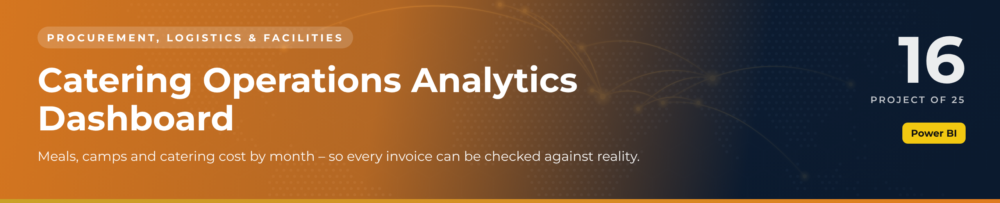
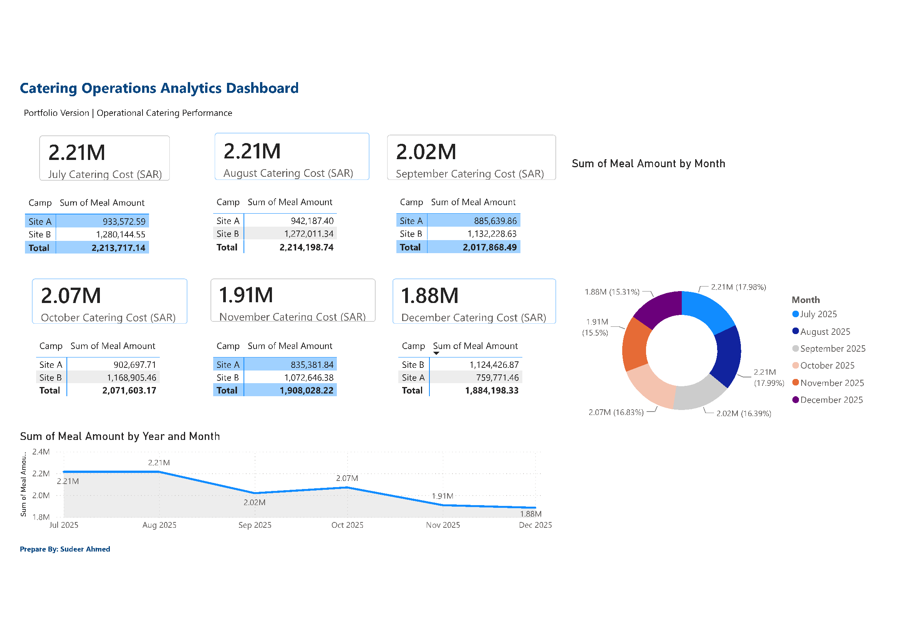

 

  

🚚 <b>Procurement, Logistics & Facilities</b> · Project 16 of 25 · <a href="https://github.com/sudheer-ahmed-khattak/Excel-Trackers-and-Management-Reports">⬅ Back to all projects</a>

---

## 🎯 The Challenge

Catering is one of the largest camp costs. Management needed to see meal volumes and cost by site and month to spot trends and challenge invoices.

## ✅ The Solution

A Power BI dashboard that tracks monthly catering cost, meal amounts, camp-wise distribution and cost trends with executive KPI cards.

## 📦 What's Inside

| Component | What it does |
|---|---|
| **Power BI report** | Monthly cost cards, camp-wise meal distribution, monthly trend and share by month |
| **PDF report** | Print-ready dashboard |

## ⭐ Key Features

- ✅ Monthly catering cost KPI cards
- ✅ Camp / site-wise meal distribution
- ✅ Cost trend across months
- ✅ Month-share donut for quick comparison
- ✅ Supports invoice verification

## 🛠️ Built With

 

## 💼 Skills Demonstrated

    

## 📥 How to Use

1. Click **DOWNLOAD POWER BI** and open the `.pbix` file in Power BI Desktop (free)
2. Use the visuals and filters to explore the data
3. Or click **OPEN PDF REPORT** to read the dashboard without installing anything

> 🔐 **Demo data:** every name, company, figure and reference in this project is fictional and created for portfolio purposes only.

---

**Sudheer Ahmed Khattak** 
Senior Executive Assistant · Board Secretariat & PMO Support · 11+ years · Saudi Arabia & Pakistan

 

