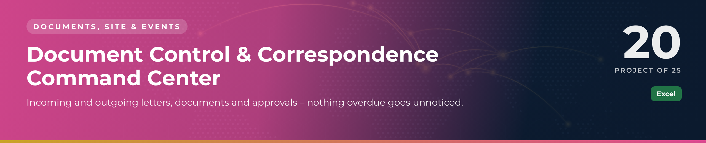
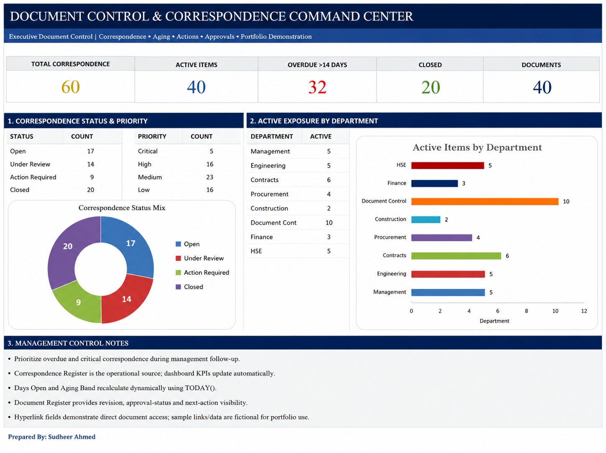

 

  

📁 <b>Documents, Site & Events</b> · Project 20 of 25 · <a href="https://github.com/sudheer-ahmed-khattak/Excel-Trackers-and-Management-Reports">⬅ Back to all projects</a>

---

## 🎯 The Challenge

Client correspondence and project documents carry contractual deadlines. A missed reply or a document stuck in review can cost the project time and money.

## ✅ The Solution

An Excel command center with correspondence and document registers feeding an executive dashboard of active, overdue and closed items, priorities and departmental exposure.

## 📦 What's Inside

| Sheet / Page | What it does |
|---|---|
| **Executive Dashboard** | Totals, active, overdue (>14 days), closed, status, priority and active items by department |
| **Correspondence Register** | Every letter with reference, dates, owner, priority and status |
| **Document Register** | Documents with review status and revision |
| **Lists** | Drop-down sources |

## ⭐ Key Features

- ✅ Overdue correspondence flagged automatically
- ✅ Active items by department for accountability
- ✅ Priority and status split for the daily brief
- ✅ Correspondence and documents in one workbook
- ✅ Management notes section for key actions

## 🛠️ Built With

 

## 💼 Skills Demonstrated

    

## 📥 How to Use

1. Click **DOWNLOAD EXCEL** and open the workbook
2. Enter or update records in the register sheets – formulas and charts refresh automatically
3. Or click **OPEN PDF REPORT** for a print-ready view of the dashboard

> 🔐 **Demo data:** every name, company, figure and reference in this project is fictional and created for portfolio purposes only.

---

**Sudheer Ahmed Khattak** 
Senior Executive Assistant · Board Secretariat & PMO Support · 11+ years · Saudi Arabia & Pakistan

 

