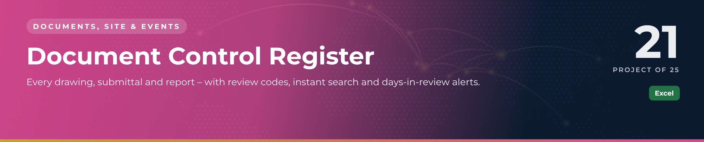
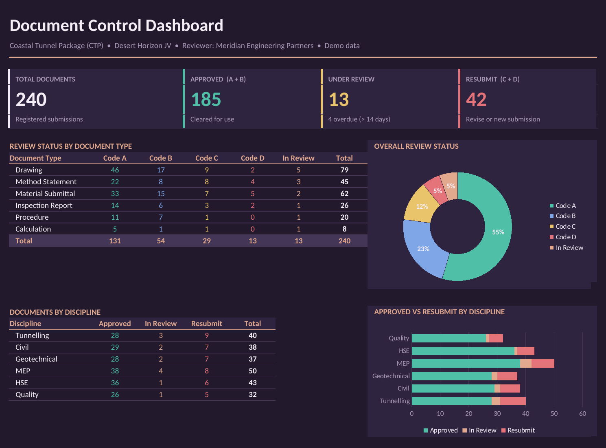

 

  

📁 <b>Documents, Site & Events</b> · Project 21 of 25 · <a href="https://github.com/sudheer-ahmed-khattak/Excel-Trackers-and-Management-Reports">⬅ Back to all projects</a>

---

## 🎯 The Challenge

Hundreds of documents move between contractor and consultant. Teams lose track of the latest revision, what needs resubmission and how long the consultant has been reviewing.

## ✅ The Solution

An Excel register with structured document numbering, colour-coded review codes, automatic days-in-review and a formula-driven search, all feeding a dashboard.

## 📦 What's Inside

| Sheet / Page | What it does |
|---|---|
| **Dashboard** | Totals by review code, document type and discipline, approvals trend |
| **Search** | Type any keyword – results and count update instantly |
| **Document Register** | Full register with numbering, revision, review code and file path |

## ⭐ Key Features

- ✅ Review codes A / B / C / D and Under Review colour-coded
- ✅ Days in review – anything over 14 days turns red
- ✅ Instant search with result count
- ✅ Structured numbering: Project–Company–Discipline–Type–Sequence
- ✅ File-location path stored for every record

## 🛠️ Built With

 

## 💼 Skills Demonstrated

    

## 📥 How to Use

1. Click **DOWNLOAD EXCEL** and open the workbook
2. Enter or update records in the register sheets – formulas and charts refresh automatically
3. Or click **OPEN PDF REPORT** for a print-ready view of the dashboard

> 🔐 **Demo data:** every name, company, figure and reference in this project is fictional and created for portfolio purposes only.

---

**Sudheer Ahmed Khattak** 
Senior Executive Assistant · Board Secretariat & PMO Support · 11+ years · Saudi Arabia & Pakistan

 

