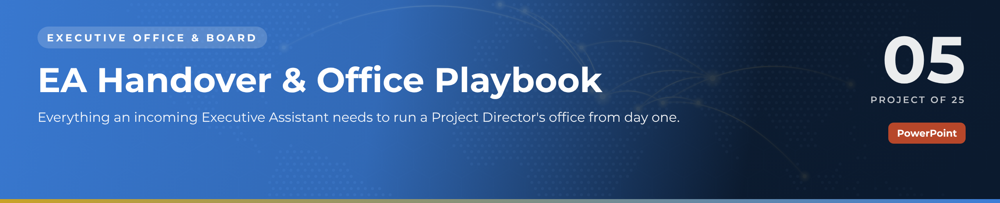
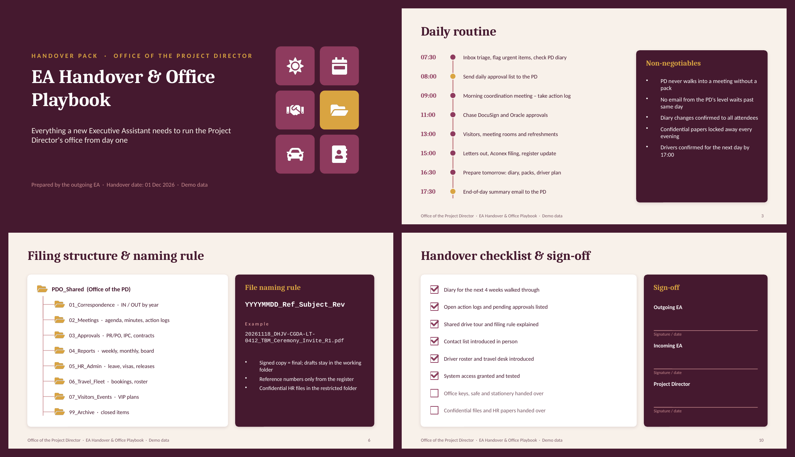

 

  

🏛️ <b>Executive Office & Board</b> · Project 05 of 25 · <a href="https://github.com/sudheer-ahmed-khattak/Excel-Trackers-and-Management-Reports">⬅ Back to all projects</a>

---

## 🎯 The Challenge

When an Executive Assistant changes, years of routines, contacts, filing logic and system access walk out of the door – and the Director feels it the next morning.

## ✅ The Solution

An 11-slide handover pack that captures the daily rhythm, weekly and monthly cycle, meeting discipline, filing rules, drivers and travel, contacts, access transfer and a formal sign-off – plus a 30-day takeover plan.

## 📦 What's Inside

| Slides | What it does |
|---|---|
| **Slides 1–2** | What the playbook covers |
| **Slides 3–4** | Daily routine and the weekly / monthly cycle |
| **Slide 5** | Meeting management – before, during and after |
| **Slide 6** | Shared-drive structure and file naming rule |
| **Slides 7–9** | Drivers & travel, key contacts, systems access transfer |
| **Slides 10–11** | Handover checklist with sign-off and the first 30 days |

## ⭐ Key Features

- ✅ Hour-by-hour daily routine with the office's non-negotiables
- ✅ File naming convention and folder tree ready to adopt
- ✅ Driver roster and a 5-step business travel process
- ✅ Signed handover checklist for Outgoing EA, Incoming EA and Director
- ✅ Shadow → co-run → own: a clear 30-day transition

## 🛠️ Built With

 

## 💼 Skills Demonstrated

    

## 📥 How to Use

1. Click **DOWNLOAD POWERPOINT** and open the deck – every slide, chart and colour is editable
2. Present it as it is, or replace the demo content with your own
3. Or click **OPEN PDF REPORT** to read it in the browser

> 🔐 **Demo data:** every name, company, figure and reference in this project is fictional and created for portfolio purposes only.

---

**Sudheer Ahmed Khattak** 
Senior Executive Assistant · Board Secretariat & PMO Support · 11+ years · Saudi Arabia & Pakistan

 

