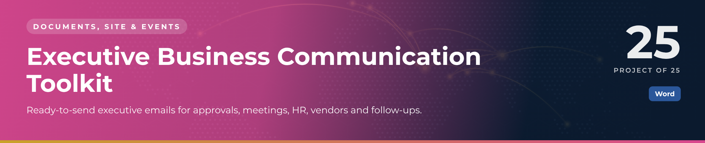
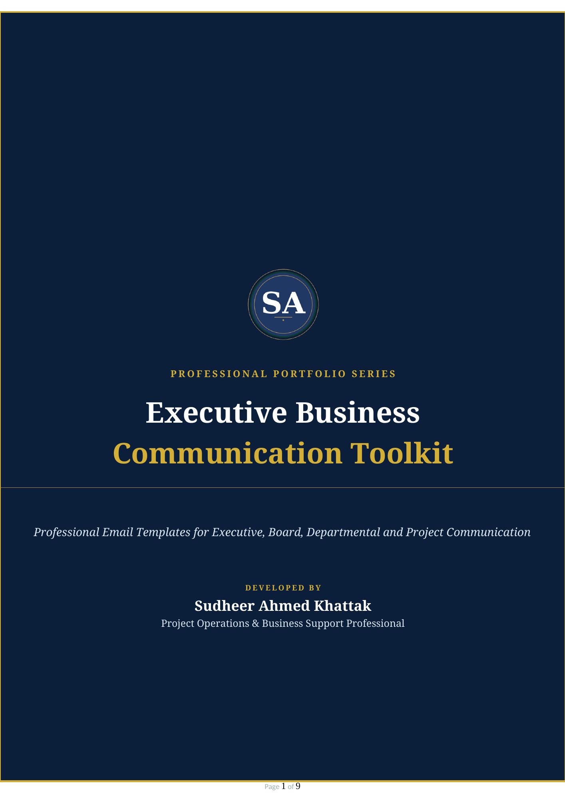

 

  

📁 <b>Documents, Site & Events</b> · Project 25 of 25 · <a href="https://github.com/sudheer-ahmed-khattak/Excel-Trackers-and-Management-Reports">⬅ Back to all projects</a>

---

## 🎯 The Challenge

Executive offices send dozens of formal emails a day. Inconsistent tone and structure slow responses and weaken the office's voice.

## ✅ The Solution

A Word toolkit of professionally structured email templates for executive office, CEO correspondence, PMO coordination, HR, vendors and clients.

## 📦 What's Inside

| Section | What it does |
|---|---|
| **Executive & CEO office** | Approvals, meeting invitations and leadership updates |
| **Project & PMO** | Coordination, follow-ups and status requests |
| **HR & employees** | Notifications and administrative communication |
| **Vendors & clients** | Formal external correspondence |

## ⭐ Key Features

- ✅ Consistent, professional executive tone
- ✅ Subject lines and structure ready to reuse
- ✅ Covers internal and external audiences
- ✅ Saves drafting time every day
- ✅ Editable Word file plus PDF

## 🛠️ Built With

 

## 💼 Skills Demonstrated

    

## 📥 How to Use

1. Click **DOWNLOAD WORD** and open the toolkit
2. Copy any template and replace the bracketed fields
3. Or click **OPEN PDF REPORT** to browse it in the browser

> 🔐 **Demo data:** every name, company, figure and reference in this project is fictional and created for portfolio purposes only.

---

**Sudheer Ahmed Khattak** 
Senior Executive Assistant · Board Secretariat & PMO Support · 11+ years · Saudi Arabia & Pakistan

 

