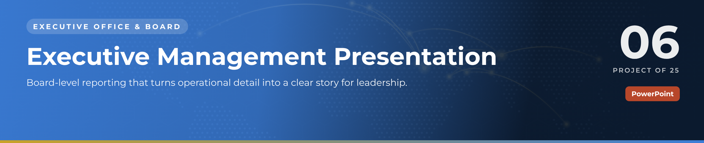
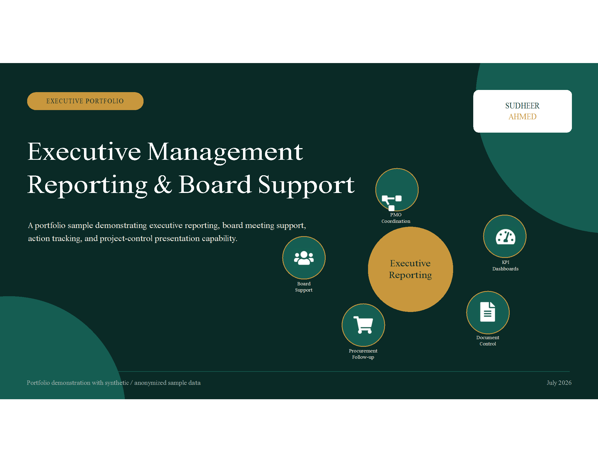

 

  

🏛️ <b>Executive Office & Board</b> · Project 06 of 25 · <a href="https://github.com/sudheer-ahmed-khattak/Excel-Trackers-and-Management-Reports">⬅ Back to all projects</a>

---

## 🎯 The Challenge

Senior leaders do not read spreadsheets in meetings. They need the position, the risks and the decisions required – on a handful of well-designed slides.

## ✅ The Solution

An 8-slide executive deck that shows how operational data becomes a KPI pack, how the board meeting cycle runs, and how documents, procurement and payments are reported to leadership.

## 📦 What's Inside

| Slides | What it does |
|---|---|
| **Slides 1–2** | Executive reporting & board support – positioning |
| **Slide 3** | Reporting operating model: raw inputs → decisions → closed actions |
| **Slide 4** | Sample executive KPI pack: status, risk and action closure |
| **Slide 5** | Board & management meeting cycle: agenda, minutes, approvals, actions |
| **Slides 6–7** | Document control reporting and procurement / payment control |
| **Slide 8** | Roadmap – how the reporting outputs map to executive roles |

## ⭐ Key Features

- ✅ Repeatable reporting flow from data to decision
- ✅ KPI pack combining status, risk and action closure
- ✅ Board meeting cycle from agenda to closed actions
- ✅ Clean, consistent executive design language
- ✅ Editable PowerPoint plus a print-ready PDF

## 🛠️ Built With

 

## 💼 Skills Demonstrated

    

## 📥 How to Use

1. Click **DOWNLOAD POWERPOINT** and open the deck – every slide, chart and colour is editable
2. Present it as it is, or replace the demo content with your own
3. Or click **OPEN PDF REPORT** to read it in the browser

> 🔐 **Demo data:** every name, company, figure and reference in this project is fictional and created for portfolio purposes only.

---

**Sudheer Ahmed Khattak** 
Senior Executive Assistant · Board Secretariat & PMO Support · 11+ years · Saudi Arabia & Pakistan

 

