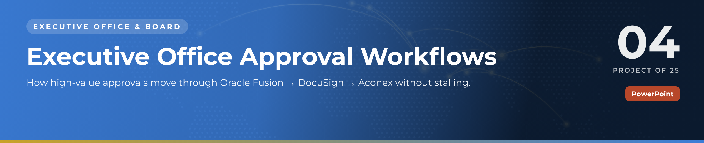

 

  

🏛️ <b>Executive Office & Board</b> · Project 04 of 25 · <a href="https://github.com/sudheer-ahmed-khattak/Excel-Trackers-and-Management-Reports">⬅ Back to all projects</a>

---

## 🎯 The Challenge

PRs, IPCs, contracts and client letters each follow a different route, owner and system. When one approver is travelling or one step is missed, payments and correspondence stall.

## ✅ The Solution

An 11-slide process playbook that maps four approval workflows step by step, defines who approves what at each value band, and shows turnaround performance and the fixes for common delays.

## 📦 What's Inside

| Slides | What it does |
|---|---|
| **Slides 1–2** | The three-system approval chain and the golden rule |
| **Slide 3** | PR → PO: six steps with owner, system and SLA |
| **Slide 4** | Subcontractor IPC swimlane across site, commercial and executive |
| **Slides 5–6** | Contracts via DocuSign and outgoing client letters via Aconex |
| **Slide 7** | Approval authority matrix by document type and value band |
| **Slides 8–11** | Turnaround vs target, monthly volume, delays & fixes, five office rules |

## ⭐ Key Features

- ✅ Four real-world workflows mapped from request to filed record
- ✅ Swimlane view of the IPC certification cycle
- ✅ Authority matrix that removes "who signs this?" questions
- ✅ Native, editable PowerPoint charts for turnaround and volume
- ✅ Practical fixes for the delays every executive office faces

## 🛠️ Built With

 

## 💼 Skills Demonstrated

    

## 📥 How to Use

1. Click **DOWNLOAD POWERPOINT** and open the deck – every slide, chart and colour is editable
2. Present it as it is, or replace the demo content with your own
3. Or click **OPEN PDF REPORT** to read it in the browser

> 🔐 **Demo data:** every name, company, figure and reference in this project is fictional and created for portfolio purposes only.

---

**Sudheer Ahmed Khattak** 
Senior Executive Assistant · Board Secretariat & PMO Support · 11+ years · Saudi Arabia & Pakistan

 

