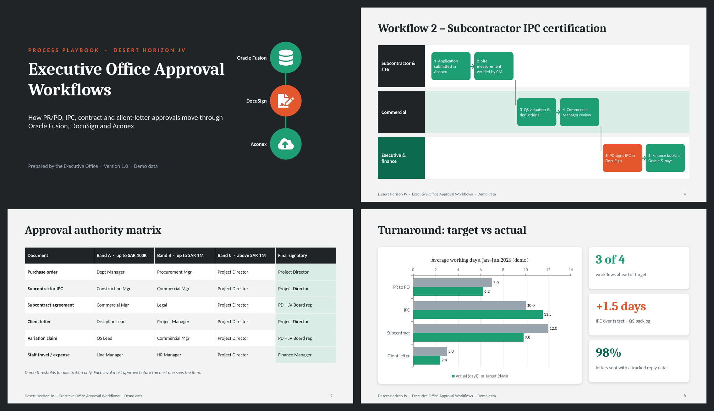

# 🔁 Executive Office Approval Workflows

An 11-slide **PowerPoint process playbook** that maps how key project documents get approved, signed and issued through **Oracle Fusion → DocuSign → Aconex**. It shows how an Executive Office keeps high-value approvals moving and keeps the record clean.

> ⚠️ **All data is fictional.** Company names, people, thresholds and figures are demo data.

## 📂 Files
| File | Description |
|---|---|
| `Executive_Office_Approval_Workflows.pptx` | Editable PowerPoint deck (16:9) |
| `Executive_Office_Approval_Workflows.pdf` | PDF version for quick viewing |
| `preview.png` | Snapshot of key slides |

## 🧭 What's inside
1. **Title**
2. **Three systems, one approval chain**: what each system does, plus the golden rule
3. **Workflow 1: PR to PO**: 6 steps with owner, system and SLA
4. **Workflow 2: Subcontractor IPC**: swimlane across site, commercial and executive
5. **Workflow 3: Contracts & subcontracts**: steps plus the pre-DocuSign checklist
6. **Workflow 4: Outgoing client letters**: draft → reference → sign → transmit → track
7. **Approval authority matrix**: approver by document type and value band
8. **Turnaround: target vs actual**: native bar chart with KPI callouts
9. **Monthly approval volume**: stacked column chart
10. **Common delays and fixes**
11. **Five rules the Executive Office follows**

## 🛠️ Skills shown
Process mapping · Approval governance · Oracle Fusion · DocuSign · Aconex · Document control · KPI reporting

## 🎨 Design
Charcoal and emerald palette with a vermilion accent. Native, editable PowerPoint charts.
