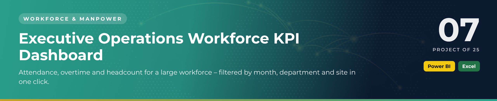
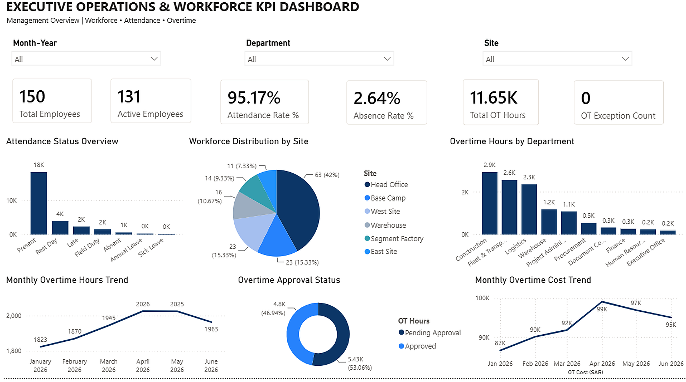

 

  

👷 <b>Workforce & Manpower</b> · Project 07 of 25 · <a href="https://github.com/sudheer-ahmed-khattak/Excel-Trackers-and-Management-Reports">⬅ Back to all projects</a>

---

## 🎯 The Challenge

With thousands of people across several sites, management could not see attendance trends, overtime cost or exceptions until month-end – too late to act.

## ✅ The Solution

An interactive Power BI dashboard on a structured Excel dataset that tracks attendance, absence, overtime hours, approval status and cost, with slicers for month, department and site.

## 📦 What's Inside

| Component | What it does |
|---|---|
| **Power BI report** | KPI cards, attendance status, site distribution, overtime by department, monthly hours and cost trends |
| **Excel dataset** | Employees, Attendance, Overtime, Departments, Calendar and KPI Targets tables |
| **PDF report** | Print-ready version of the dashboard |

## ⭐ Key Features

- ✅ Attendance and absence rate at a glance
- ✅ Overtime hours and cost trend by month
- ✅ Approved vs pending overtime and exception count
- ✅ Interactive month, department and site filters
- ✅ Star-schema data model with Power Query and DAX

## 🛠️ Built With

  

## 💼 Skills Demonstrated

    

## 📥 How to Use

1. Click **DOWNLOAD POWER BI** and open the `.pbix` file in Power BI Desktop (free)
2. Click **DOWNLOAD EXCEL** for the source data behind the dashboard
3. Or click **OPEN PDF REPORT** to read the dashboard without installing anything

> 🔐 **Demo data:** every name, company, figure and reference in this project is fictional and created for portfolio purposes only.

---

**Sudheer Ahmed Khattak** 
Senior Executive Assistant · Board Secretariat & PMO Support · 11+ years · Saudi Arabia & Pakistan

 

