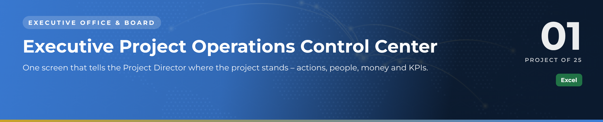
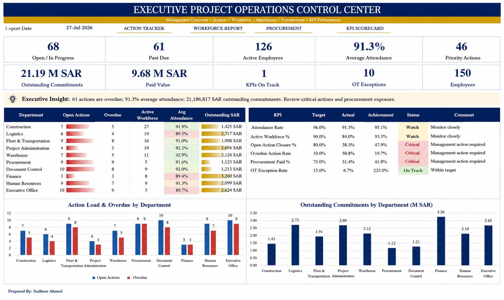

 

  

🏛️ <b>Executive Office & Board</b> · Project 01 of 25 · <a href="https://github.com/sudheer-ahmed-khattak/Excel-Trackers-and-Management-Reports">⬅ Back to all projects</a>

---

## 🎯 The Challenge

Leadership was chasing five different reports to answer one question: are we on track? Overdue actions, attendance, procurement commitments and KPI results all lived in separate files.

## ✅ The Solution

A single Excel control center that rolls actions, workforce, procurement and KPI targets into one executive view – with past-due items, departmental exposure and KPI status flagged automatically.

## 📦 What's Inside

| Sheet / Page | What it does |
|---|---|
| **Executive Dashboard** | Headline KPIs, action load, overdue items and outstanding commitments by department |
| **Action Tracker** | Every management action with owner, priority, due date and status |
| **Workforce & Attendance** | Active headcount, attendance rate and overtime exceptions |
| **Procurement & Payment** | Commitments, paid value and outstanding balance by department |
| **KPI Scorecard** | Target vs actual with on-track / watch / critical status |
| **Lists** | Drop-down sources that keep data entry clean |

## ⭐ Key Features

- ✅ Past-due and priority actions surfaced the moment they slip
- ✅ KPI scorecard with automatic On Track / Watch / Critical status
- ✅ Departmental exposure: action load and outstanding SAR side by side
- ✅ Executive insight line that summarises the position in one sentence
- ✅ Print-ready one-page layout for management meetings

## 🛠️ Built With

 

## 💼 Skills Demonstrated

    

## 📥 How to Use

1. Click **DOWNLOAD EXCEL** and open the workbook
2. Enter or update records in the register sheets – formulas and charts refresh automatically
3. Or click **OPEN PDF REPORT** for a print-ready view of the dashboard

> 🔐 **Demo data:** every name, company, figure and reference in this project is fictional and created for portfolio purposes only.

---

**Sudheer Ahmed Khattak** 
Senior Executive Assistant · Board Secretariat & PMO Support · 11+ years · Saudi Arabia & Pakistan

 

