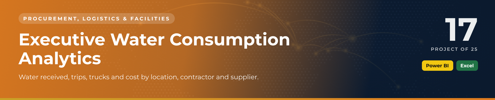
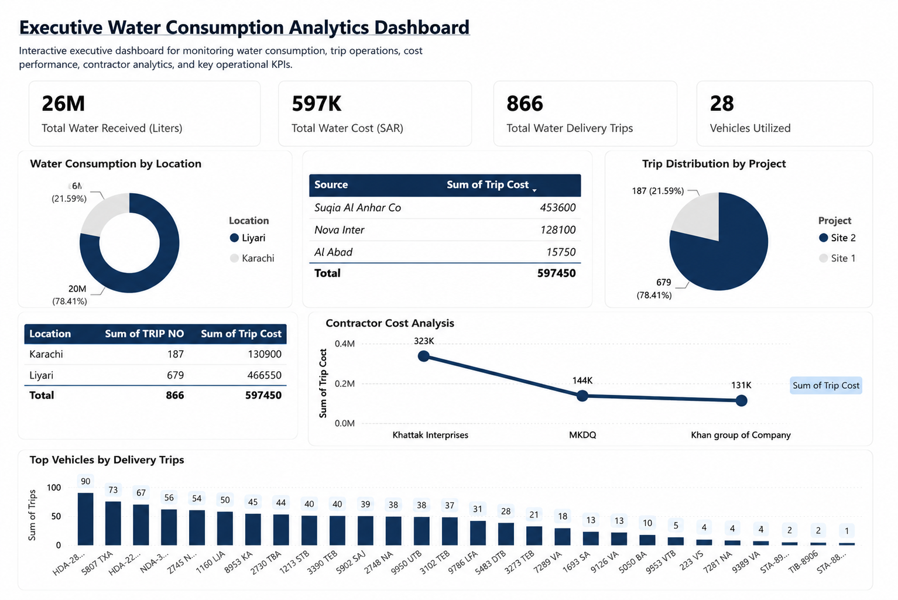

 

  

🚚 <b>Procurement, Logistics & Facilities</b> · Project 17 of 25 · <a href="https://github.com/sudheer-ahmed-khattak/Excel-Trackers-and-Management-Reports">⬅ Back to all projects</a>

---

## 🎯 The Challenge

Water deliveries were recorded on paper delivery notes. Management could not see consumption by location, trips per truck or what each contractor was costing.

## ✅ The Solution

A Power BI dashboard on a delivery-note dataset that reports litres received, trip count, cost, active vehicles and contractor / supplier performance by location and project.

## 📦 What's Inside

| Component | What it does |
|---|---|
| **Power BI report** | KPI cards, consumption by location, trips by project, contractor and supplier cost, top vehicles |
| **Excel data** | Delivery-note master data |
| **PDF report** | Print-ready dashboard |

## ⭐ Key Features

- ✅ Total litres, cost, trips and active vehicles
- ✅ Consumption by location and purpose
- ✅ Contractor and supplier cost comparison
- ✅ Top vehicles by delivery trips
- ✅ Built from delivery notes – ready for invoice reconciliation

## 🛠️ Built With

  

## 💼 Skills Demonstrated

    

## 📥 How to Use

1. Click **DOWNLOAD POWER BI** and open the `.pbix` file in Power BI Desktop (free)
2. Click **DOWNLOAD EXCEL** for the source data behind the dashboard
3. Or click **OPEN PDF REPORT** to read the dashboard without installing anything

> 🔐 **Demo data:** every name, company, figure and reference in this project is fictional and created for portfolio purposes only.

---

**Sudheer Ahmed Khattak** 
Senior Executive Assistant · Board Secretariat & PMO Support · 11+ years · Saudi Arabia & Pakistan

 

