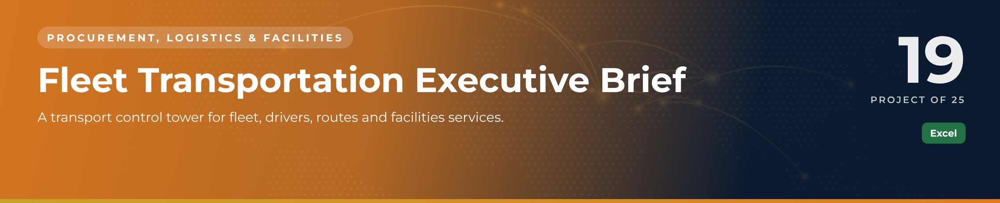
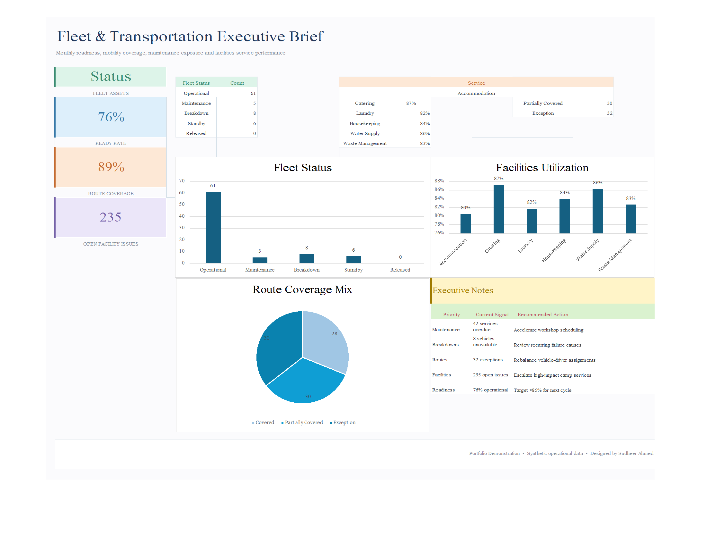

 

  

🚚 <b>Procurement, Logistics & Facilities</b> · Project 19 of 25 · <a href="https://github.com/sudheer-ahmed-khattak/Excel-Trackers-and-Management-Reports">⬅ Back to all projects</a>

---

## 🎯 The Challenge

Moving thousands of workers every day depends on vehicles, drivers and routes being ready. Breakdowns and gaps were discovered at the gate, not before.

## ✅ The Solution

An Excel control tower that brings the fleet register, driver and route plan and facilities services together, with availability and utilisation KPIs for the morning brief.

## 📦 What's Inside

| Sheet / Page | What it does |
|---|---|
| **Control Tower** | Fleet availability, utilisation, trips and status KPIs |
| **Fleet Register** | Vehicles with type, status and assignment |
| **Driver & Route Plan** | Driver allocation by route and shift |
| **Facilities Services** | Linked facilities service tracking |
| **Lists** | Drop-down sources |

## ⭐ Key Features

- ✅ Morning-brief KPIs for availability and utilisation
- ✅ Vehicle status and assignment in one register
- ✅ Driver and route plan by shift
- ✅ Facilities services linked to transport
- ✅ Ready to print for the daily operations meeting

## 🛠️ Built With

 

## 💼 Skills Demonstrated

    

## 📥 How to Use

1. Click **DOWNLOAD EXCEL** and open the workbook
2. Enter or update records in the register sheets – formulas and charts refresh automatically
3. Or click **OPEN PDF REPORT** for a print-ready view of the dashboard

> 🔐 **Demo data:** every name, company, figure and reference in this project is fictional and created for portfolio purposes only.

---

**Sudheer Ahmed Khattak** 
Senior Executive Assistant · Board Secretariat & PMO Support · 11+ years · Saudi Arabia & Pakistan

 

