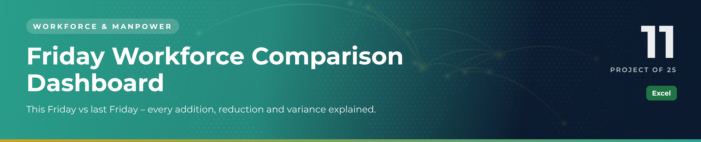
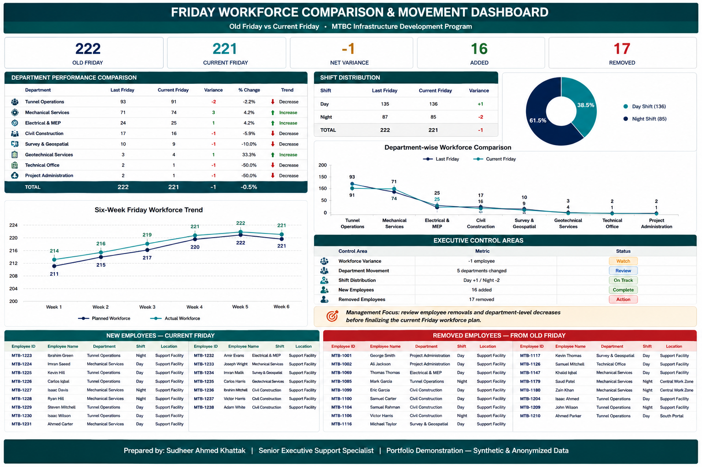

 

  

👷 <b>Workforce & Manpower</b> · Project 11 of 25 · <a href="https://github.com/sudheer-ahmed-khattak/Excel-Trackers-and-Management-Reports">⬅ Back to all projects</a>

---

## 🎯 The Challenge

Weekly manpower reports were compared by eye. Additions and removals were missed, and department variances could not be explained to management.

## ✅ The Solution

An Excel comparison report that matches two Friday workforce lists and shows added and removed employees, variance by department and location, and the net movement.

## 📦 What's Inside

| Sheet / Page | What it does |
|---|---|
| **Old Friday** | Previous week workforce list |
| **Current Friday** | This week workforce list |
| **Comparison Report** | Added / removed staff, variance by department and location, KPI cards |

## ⭐ Key Features

- ✅ Automatic match of two weekly lists
- ✅ Added and removed employees listed by name
- ✅ Variance by department and by location
- ✅ Net movement KPI cards for management
- ✅ Repeatable every week – paste and refresh

## 🛠️ Built With

 

## 💼 Skills Demonstrated

    

## 📥 How to Use

1. Click **DOWNLOAD EXCEL** and open the workbook
2. Enter or update records in the register sheets – formulas and charts refresh automatically
3. Or click **OPEN PDF REPORT** for a print-ready view of the dashboard

> 🔐 **Demo data:** every name, company, figure and reference in this project is fictional and created for portfolio purposes only.

---

**Sudheer Ahmed Khattak** 
Senior Executive Assistant · Board Secretariat & PMO Support · 11+ years · Saudi Arabia & Pakistan

 

