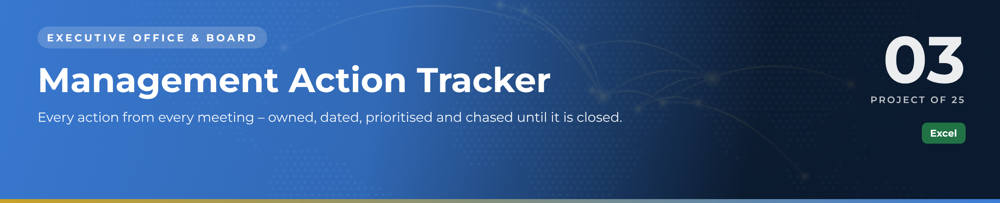
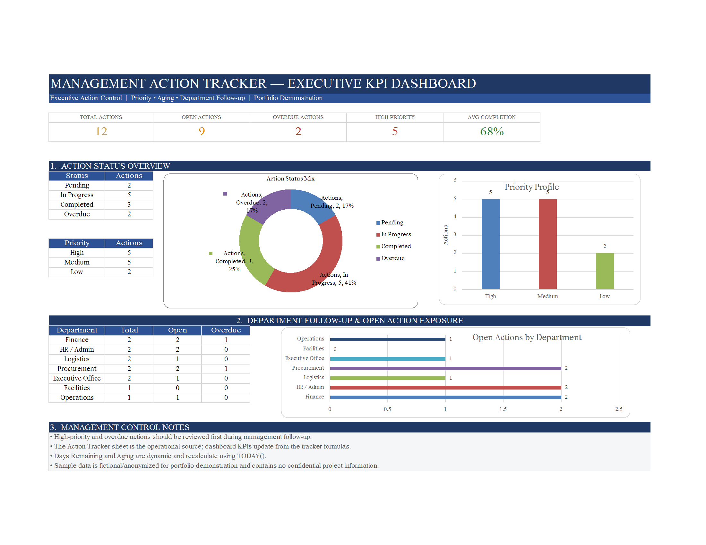

 

  

🏛️ <b>Executive Office & Board</b> · Project 03 of 25 · <a href="https://github.com/sudheer-ahmed-khattak/Excel-Trackers-and-Management-Reports">⬅ Back to all projects</a>

---

## 🎯 The Challenge

Decisions taken in management meetings were getting lost between minutes and inboxes. Nobody could say how many actions were open, who owned them or how long they had been waiting.

## ✅ The Solution

An Excel tracker with an executive dashboard that shows open, overdue and high-priority actions, ageing and owner performance – the same list the Executive Office prints for the CEO's daily agenda.

## 📦 What's Inside

| Sheet / Page | What it does |
|---|---|
| **Executive Dashboard** | Status split, priority profile, ageing buckets, department follow-up and completion rate |
| **Action Tracker** | Action, owner, department, priority, due date, status and comments |

## ⭐ Key Features

- ✅ Ageing analysis shows exactly how long actions have been waiting
- ✅ Priority profile keeps the critical few in front of leadership
- ✅ Owner and department views drive accountability
- ✅ Filter open items and print – ready for the daily agenda
- ✅ Completion rate KPI to measure follow-up discipline

## 🛠️ Built With

 

## 💼 Skills Demonstrated

    

## 📥 How to Use

1. Click **DOWNLOAD EXCEL** and open the workbook
2. Enter or update records in the register sheets – formulas and charts refresh automatically
3. Or click **OPEN PDF REPORT** for a print-ready view of the dashboard

> 🔐 **Demo data:** every name, company, figure and reference in this project is fictional and created for portfolio purposes only.

---

**Sudheer Ahmed Khattak** 
Senior Executive Assistant · Board Secretariat & PMO Support · 11+ years · Saudi Arabia & Pakistan

 

