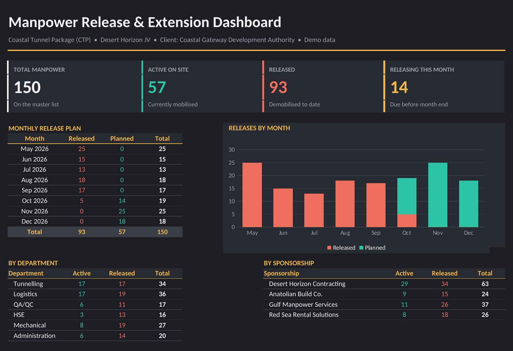

# 👷 Manpower Release & Extension Planner

An Excel workbook that keeps a project's site manpower list in one place – who is still on site, who has been released, and who is due to leave each month – with a **one-click search and update** so planners never edit dates sheet by sheet.

## 🎯 Business Problem
On large construction projects, release and extension dates change every week. When the same person appears in several lists, dates drift out of sync and management loses a clear picture of active manpower.

## ✅ Solution
| Sheet | What it does |
|---|---|
| **Dashboard** | KPI cards (total, active, released, releasing this month), monthly release plan with chart, breakdown by department and sponsorship |
| **Search** | Type a name, ID, department, sponsorship or status – matching employees appear instantly. Enter a **New Status** / **New Release Date** and press **UPDATE** |
| **Master Data** | 150 employees with nationality, department, designation, category, sponsorship, join date, status, release date and an automatic update log |

## ⚙️ Key Features
- **UPDATE button (VBA macro)** writes changes from the Search sheet into Master Data, logs every change with the date, clears the inputs and refreshes all figures
- Formula-driven search (no filters to reset) and dropdown validation for status and dates
- Colour-coded status (Active / Released) and a stacked monthly release chart
- Every figure on the dashboard updates automatically from Master Data

## 🛠️ Tools
Microsoft Excel • VBA • COUNTIFS / INDEX / SMALL formulas • Data Validation • Conditional Formatting • Excel Charts

## 📥 How to Use
1. Download **Manpower_Release_Extension_Planner.xlsm**
2. Right-click the file → **Properties** → tick **Unblock** → OK (Windows blocks macros in downloaded files)
3. Open the file and click **Enable Content**
4. Go to **Search**, type a name or ID, fill in New Status / New Release Date and press **UPDATE**

The macro source code is included as `UpdateRecords.bas`.

📄 A one-page PDF of the dashboard is included: **Manpower_Release_Extension_Planner.pdf**

> 🛡️ All names, employee IDs, companies, sponsorships and the client are fictional demo data.
