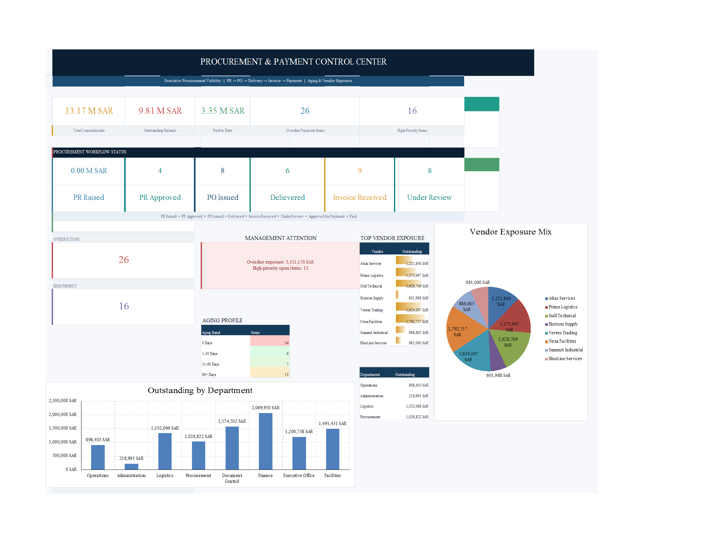

 

  

🚚 <b>Procurement, Logistics & Facilities</b> · Project 18 of 25 · <a href="https://github.com/sudheer-ahmed-khattak/Excel-Trackers-and-Management-Reports">⬅ Back to all projects</a>

---

## 🎯 The Challenge

Purchase requests, POs, deliveries, invoices and payments were tracked by different teams. Nobody had one answer to "what do we owe, to whom, and what is overdue?"

## ✅ The Solution

An Excel control center that follows every request through the procurement pipeline and reports commitments, paid to date, outstanding and overdue amounts and vendor exposure.

## 📦 What's Inside

| Sheet / Page | What it does |
|---|---|
| **Executive Dashboard** | Commitments, outstanding, paid, overdue, workflow pipeline and vendor mix |
| **Procurement Register** | PR, PO, delivery, invoice and payment status per item |
| **Vendor Summary** | Exposure and outstanding by vendor |
| **Lists** | Drop-down sources |

## ⭐ Key Features

- ✅ Pipeline view: PR raised → approved → PO → delivered → invoiced → paid
- ✅ Outstanding and overdue amounts by department
- ✅ Vendor exposure ranking
- ✅ High-priority issues flagged for management
- ✅ Single register – no duplicate tracking

## 🛠️ Built With

 

## 💼 Skills Demonstrated

    

## 📥 How to Use

1. Click **DOWNLOAD EXCEL** and open the workbook
2. Enter or update records in the register sheets – formulas and charts refresh automatically
3. Or click **OPEN PDF REPORT** for a print-ready view of the dashboard

> 🔐 **Demo data:** every name, company, figure and reference in this project is fictional and created for portfolio purposes only.

---

**Sudheer Ahmed Khattak** 
Senior Executive Assistant · Board Secretariat & PMO Support · 11+ years · Saudi Arabia & Pakistan

 

