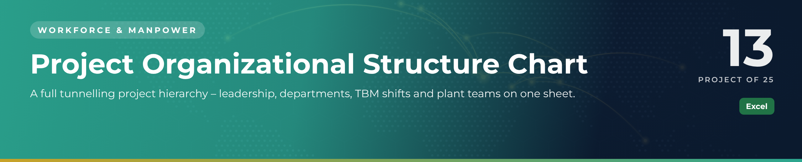
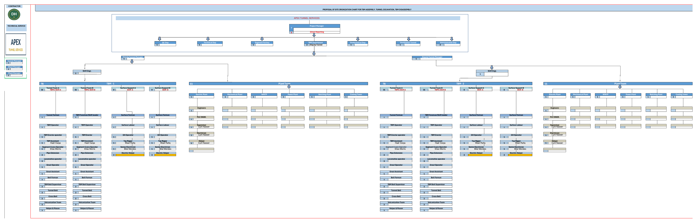

 

  

👷 <b>Workforce & Manpower</b> · Project 13 of 25 · <a href="https://github.com/sudheer-ahmed-khattak/Excel-Trackers-and-Management-Reports">⬅ Back to all projects</a>

---

## 🎯 The Challenge

Twin TBM drives involve hundreds of people across tunnel, surface and plant teams. New staff, visitors and the client need to see who reports to whom at a glance.

## ✅ The Solution

An Excel organisation chart that maps project leadership, seven departments, two TBM teams with shift structure, surface support and plant teams, with headcount on every box.

## 📦 What's Inside

| Sheet / Page | What it does |
|---|---|
| **Tunnel Org (3)** | Main site organisation chart for TBM assembly, excavation and disassembly |
| **Tunnel Org (2)** | Detailed tunnel and plant team breakdown |
| **Tunnel Org 1** | Simplified management-level structure |

## ⭐ Key Features

- ✅ Leadership, departments and shift teams in one view
- ✅ Headcount shown on every role box
- ✅ Direct and functional reporting lines
- ✅ Print-ready A3 layout
- ✅ Editable in Excel for any project

## 🛠️ Built With

 

## 💼 Skills Demonstrated

    

## 📥 How to Use

1. Click **DOWNLOAD EXCEL** and open the workbook
2. Enter or update records in the register sheets – formulas and charts refresh automatically
3. Or click **OPEN PDF REPORT** for a print-ready view of the dashboard

> 🔐 **Demo data:** every name, company, figure and reference in this project is fictional and created for portfolio purposes only.

---

**Sudheer Ahmed Khattak** 
Senior Executive Assistant · Board Secretariat & PMO Support · 11+ years · Saudi Arabia & Pakistan

 

