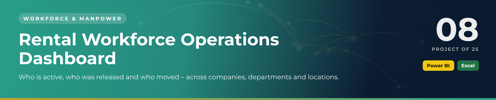

 

  

👷 <b>Workforce & Manpower</b> · Project 08 of 25 · <a href="https://github.com/sudheer-ahmed-khattak/Excel-Trackers-and-Management-Reports">⬅ Back to all projects</a>

---

## 🎯 The Challenge

Rental and direct-hire manpower changes daily. Without one view, transfers go unrecorded, released staff stay on lists and headcount by manager is a guess.

## ✅ The Solution

A Power BI dashboard backed by an Excel workforce master that tracks active, released and transferred staff by category, department, location, company and reporting manager.

## 📦 What's Inside

| Component | What it does |
|---|---|
| **Power BI report** | Active / released / transferred KPIs, category split, department headcount, location and manager views |
| **Excel data** | Master employee data, time sheets, transfers, releases and manpower master |
| **PDF report** | Print-ready version of the dashboard |

## ⭐ Key Features

- ✅ Active, released and transferred workforce KPIs
- ✅ Headcount by department, location and reporting manager
- ✅ Released workforce by company for invoice checks
- ✅ Transfer tracking with category detail
- ✅ Clean model ready for monthly refresh

## 🛠️ Built With

  

## 💼 Skills Demonstrated

    

## 📥 How to Use

1. Click **DOWNLOAD POWER BI** and open the `.pbix` file in Power BI Desktop (free)
2. Click **DOWNLOAD EXCEL** for the source data behind the dashboard
3. Or click **OPEN PDF REPORT** to read the dashboard without installing anything

> 🔐 **Demo data:** every name, company, figure and reference in this project is fictional and created for portfolio purposes only.

---

**Sudheer Ahmed Khattak** 
Senior Executive Assistant · Board Secretariat & PMO Support · 11+ years · Saudi Arabia & Pakistan

 

