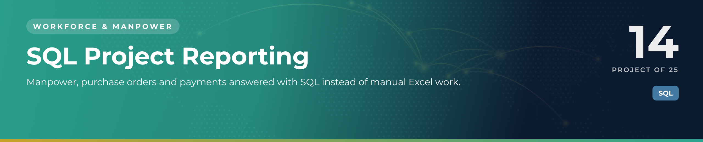

 

  

👷 <b>Workforce & Manpower</b> · Project 14 of 25 · <a href="https://github.com/sudheer-ahmed-khattak/Excel-Trackers-and-Management-Reports">⬅ Back to all projects</a>

---

## 🎯 The Challenge

Questions like "how much is still unpaid on each PO?" or "who is due for release next month?" took hours of VLOOKUPs across several sheets.

## ✅ The Solution

A relational SQLite database with five linked tables and 20 report queries – from basic filters to PO-vs-payment balances, supplier summaries and a live active-manpower view.

## 📦 What's Inside

| File | What it does |
|---|---|
| **01_create_and_insert.sql** | Tables with primary/foreign keys and validation rules, plus demo data |
| **02_report_queries.sql** | 20 queries from basic to management reports |
| **Project_Demo.db** | Ready-to-open SQLite database |

## ⭐ Key Features

- ✅ PO vs payment: paid, pending and outstanding per PO
- ✅ Supplier-wise PO value and payments
- ✅ Monthly release forecast with TBD handling
- ✅ POs with no payment request yet
- ✅ v_active_manpower view – a live report

## 🛠️ Built With

 

## 💼 Skills Demonstrated

    

## 📥 How to Use

1. Install **DB Browser for SQLite** (free) and open `Project_Demo.db`
2. Open the **Execute SQL** tab
3. Paste any query from `02_report_queries.sql` and press ▶ Run

> 🔐 **Demo data:** every name, company, figure and reference in this project is fictional and created for portfolio purposes only.

---

**Sudheer Ahmed Khattak** 
Senior Executive Assistant · Board Secretariat & PMO Support · 11+ years · Saudi Arabia & Pakistan

 

