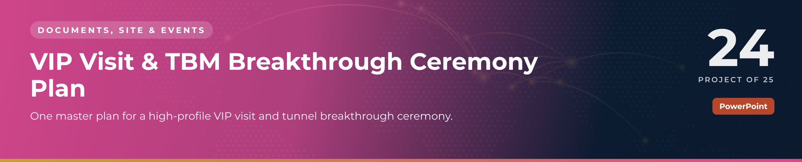

 

  

📁 <b>Documents, Site & Events</b> · Project 24 of 25 · <a href="https://github.com/sudheer-ahmed-khattak/Excel-Trackers-and-Management-Reports">⬅ Back to all projects</a>

---

## 🎯 The Challenge

A breakthrough ceremony brings the client's leadership, media and hundreds of guests onto an active construction site. Security, protocol, transport and safety must work to the minute.

## ✅ The Solution

An 11-slide event plan covering run of show, guest protocol tiers, security zones, convoy movement, hospitality, roles, a readiness countdown and a risk plan.

## 📦 What's Inside

| Slides | What it does |
|---|---|
| **Slides 1–2** | Event overview and key details |
| **Slide 3** | Minute-by-minute run of show |
| **Slides 4–5** | Guest tiers with seating and security zones A → D |
| **Slides 6–7** | Convoy and movement plan, catering and hospitality |
| **Slides 8–9** | Roles & responsibilities and T-14 → D-Day countdown |
| **Slides 10–11** | Risks & contingency and command-centre contacts |

## ⭐ Key Features

- ✅ Run of show from advance team to departure
- ✅ Five protocol tiers with escorts and seating
- ✅ Wristband colour code and zone access rules
- ✅ Convoy table with drivers and timings
- ✅ Rated risks with mitigation and owners

## 🛠️ Built With

 

## 💼 Skills Demonstrated

    

## 📥 How to Use

1. Click **DOWNLOAD POWERPOINT** and open the deck – every slide, chart and colour is editable
2. Present it as it is, or replace the demo content with your own
3. Or click **OPEN PDF REPORT** to read it in the browser

> 🔐 **Demo data:** every name, company, figure and reference in this project is fictional and created for portfolio purposes only.

---

**Sudheer Ahmed Khattak** 
Senior Executive Assistant · Board Secretariat & PMO Support · 11+ years · Saudi Arabia & Pakistan

 

