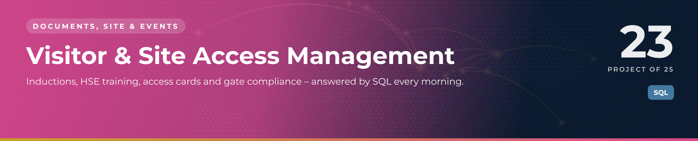

 

  

📁 <b>Documents, Site & Events</b> · Project 23 of 25 · <a href="https://github.com/sudheer-ahmed-khattak/Excel-Trackers-and-Management-Reports">⬅ Back to all projects</a>

---

## 🎯 The Challenge

Security and HSE need to know, every day, who is on site, whose card is expiring, who has not been inducted and who holds high-risk access without valid training.

## ✅ The Solution

A SQLite database of nine linked tables covering companies, people, inductions, HSE training, access cards, zone permissions, PPE and visits – with 20 compliance and management queries.

## 📦 What's Inside

| File | What it does |
|---|---|
| **01_schema_and_data.sql** | Nine tables with keys, CHECK rules and indexes, plus demo data |
| **02_report_queries.sql** | 20 queries from look-ups to compliance alerts |
| **Visitor_Access.db** | Ready-to-open SQLite database |

## ⭐ Key Features

- ✅ Who is on site right now
- ✅ Cards expiring in the next 30 days
- ✅ High-risk zone access without valid HSE training
- ✅ Visits into zones the card does not open
- ✅ Company compliance scorecard and a gate-status view

## 🛠️ Built With

 

## 💼 Skills Demonstrated

    

## 📥 How to Use

1. Install **DB Browser for SQLite** (free) and open `Visitor_Access.db`
2. Open the **Execute SQL** tab
3. Paste any query from `02_report_queries.sql` and press ▶ Run

> 🔐 **Demo data:** every name, company, figure and reference in this project is fictional and created for portfolio purposes only.

---

**Sudheer Ahmed Khattak** 
Senior Executive Assistant · Board Secretariat & PMO Support · 11+ years · Saudi Arabia & Pakistan

 

