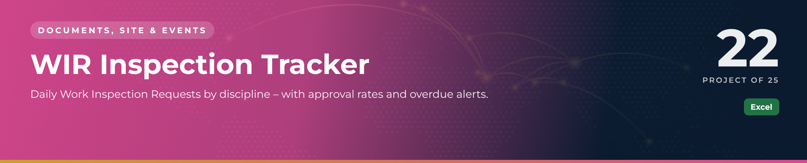

 

  

📁 <b>Documents, Site & Events</b> · Project 22 of 25 · <a href="https://github.com/sudheer-ahmed-khattak/Excel-Trackers-and-Management-Reports">⬅ Back to all projects</a>

---

## 🎯 The Challenge

Site teams raise dozens of WIRs a day across disciplines. Pending inspections were missed, rejected work was not re-inspected on time, and management had no daily view.

## ✅ The Solution

An Excel tracker with a WIR register, a daily submission log and a dashboard showing status, approval % by discipline and monthly trend.

## 📦 What's Inside

| Sheet / Page | What it does |
|---|---|
| **Dashboard** | Total, approved, pending and overdue WIRs, status by discipline, monthly trend |
| **WIR Register** | Every WIR with discipline, activity, location, inspector, status and days open |
| **Daily Log** | Submissions per discipline per working day |

## ⭐ Key Features

- ✅ Days open calculated automatically
- ✅ Pending WIRs older than 3 days turn red
- ✅ Approval % per discipline
- ✅ Daily log updates itself from the register
- ✅ Monthly trend chart for progress meetings

## 🛠️ Built With

 

## 💼 Skills Demonstrated

    

## 📥 How to Use

1. Click **DOWNLOAD EXCEL** and open the workbook
2. Enter or update records in the register sheets – formulas and charts refresh automatically
3. Or click **OPEN PDF REPORT** for a print-ready view of the dashboard

> 🔐 **Demo data:** every name, company, figure and reference in this project is fictional and created for portfolio purposes only.

---

**Sudheer Ahmed Khattak** 
Senior Executive Assistant · Board Secretariat & PMO Support · 11+ years · Saudi Arabia & Pakistan

 

