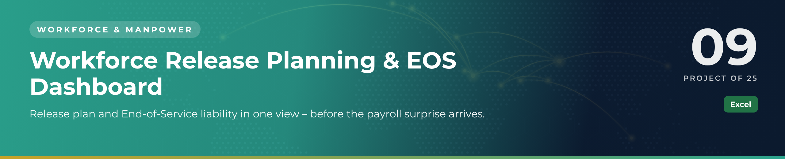

 

  

👷 <b>Workforce & Manpower</b> · Project 09 of 25 · <a href="https://github.com/sudheer-ahmed-khattak/Excel-Trackers-and-Management-Reports">⬅ Back to all projects</a>

---

## 🎯 The Challenge

Demobilisation decisions carry real money: every release triggers an End-of-Service settlement. Leadership needed to see the liability and the risk before approving the plan.

## ✅ The Solution

An Excel dashboard that pairs the release plan with EOS liability, sponsorship exposure, department headcount and a workforce risk profile.

## 📦 What's Inside

| Sheet / Page | What it does |
|---|---|
| **KPI Report** | Total and average EOS liability, risk levels, department, sponsorship and nationality views |
| **Release Plan** | Employee-level plan with release dates and liability |

## ⭐ Key Features

- ✅ Total and average EOS liability calculated automatically
- ✅ High / medium risk employees highlighted
- ✅ Liability by department for budget owners
- ✅ Sponsorship and nationality distribution
- ✅ Built for demobilisation and closeout planning

## 🛠️ Built With

 

## 💼 Skills Demonstrated

    

## 📥 How to Use

1. Click **DOWNLOAD EXCEL** and open the workbook
2. Enter or update records in the register sheets – formulas and charts refresh automatically
3. Or click **OPEN PDF REPORT** for a print-ready view of the dashboard

> 🔐 **Demo data:** every name, company, figure and reference in this project is fictional and created for portfolio purposes only.

---

**Sudheer Ahmed Khattak** 
Senior Executive Assistant · Board Secretariat & PMO Support · 11+ years · Saudi Arabia & Pakistan

 

