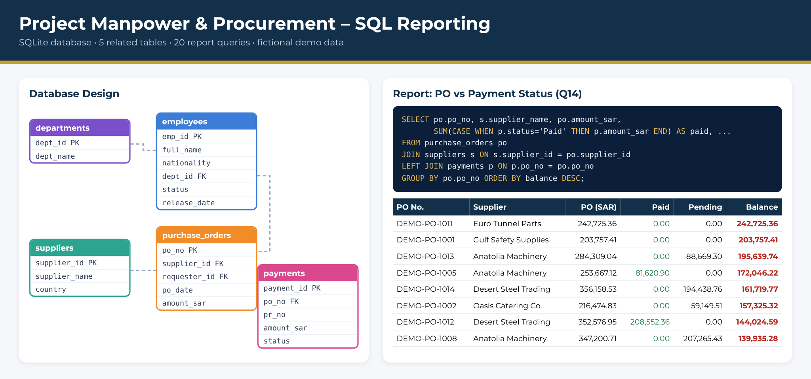

# 🗄️ Project Manpower & Procurement – SQL Reporting

A small relational database for a construction project, built to show how management reports are produced with SQL instead of manual Excel work.
📄 A one-page PDF of the dashboard is included: **SQL_Project_Reporting.pdf**

> 🛡️ All names, IDs, suppliers and amounts are fictional demo data.

## Database design
| Table | What it holds | Key links |
|---|---|---|
| `departments` | 8 project departments | – |
| `employees` | 36 staff/labor with status and release date | `dept_id → departments` |
| `suppliers` | 6 suppliers | – |
| `purchase_orders` | 16 POs with amount (SAR) | `supplier_id → suppliers`, `requester_id → employees` |
| `payments` | 23 payment requests (Paid / Pending / Rejected) | `po_no → purchase_orders` |

## Files
- `01_create_and_insert.sql` – creates the tables (with primary/foreign keys and validation rules) and loads the data
- `02_report_queries.sql` – 20 queries, from basic filters to management reports
- `Project_Demo.db` – ready-to-open SQLite database

## Reports included
- Active vs released manpower, by nationality and department
- Monthly release forecast (people without a release date shown as TBD)
- PO vs payment status: paid, pending and outstanding balance per PO
- Supplier-wise PO value and payments
- POs with no payment request yet, and released employees still holding POs
- `v_active_manpower` view – a live "Active Manpower" report

## Skills shown
`SELECT` · `WHERE` · `ORDER BY` · `GROUP BY / HAVING` · `JOIN / LEFT JOIN` · `CASE WHEN` · sub-queries · `VIEW` · `UPDATE` · constraints (`PRIMARY KEY`, `FOREIGN KEY`, `CHECK`, `NOT NULL`)

## How to run
Open `Project_Demo.db` in [DB Browser for SQLite](https://sqlitebrowser.org/) (free) → **Execute SQL** tab → paste any query from `02_report_queries.sql` → ▶ Run.
Or paste both `.sql` files into [sqliteonline.com](https://sqliteonline.com/).
