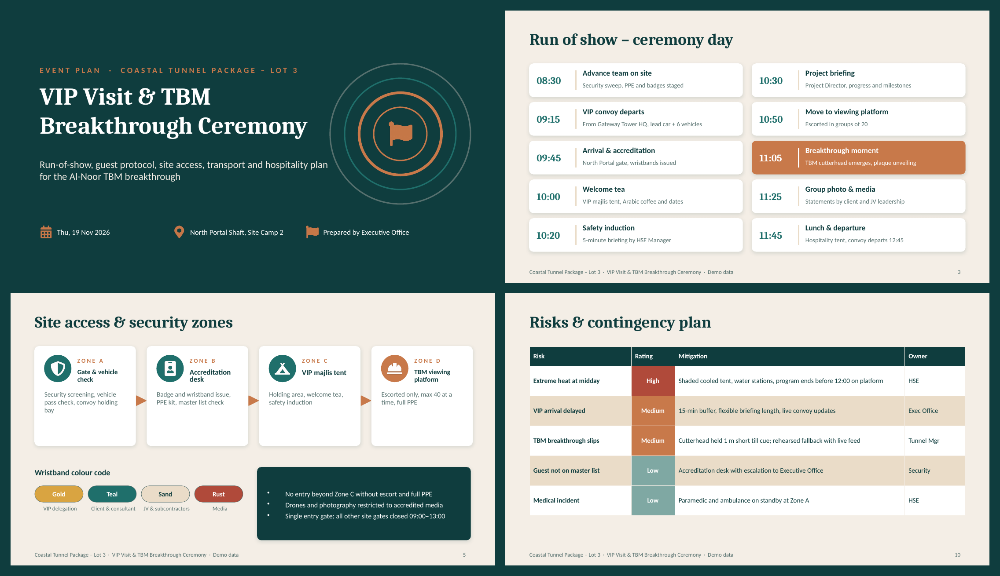

# 🎉 VIP Visit & TBM Breakthrough Ceremony Plan

An 11-slide **PowerPoint event plan** for a high-profile VIP visit and tunnel boring machine (TBM) breakthrough ceremony on a mega infrastructure project. It is built the way an Executive Office plans a real ceremony: one master plan that every workstream lead can follow.

> ⚠️ **All data is fictional.** Client, contractor, names, phone numbers and figures are demo data.

## 📂 Files
| File | Description |
|---|---|
| `VIP_Visit_TBM_Ceremony_Plan.pptx` | Editable PowerPoint deck (16:9) |
| `VIP_Visit_TBM_Ceremony_Plan.pdf` | PDF version for quick viewing |
| `preview.png` | Snapshot of key slides |

## 🧭 What's inside
1. **Title**: event, date and venue
2. **Event at a glance**: KPIs, objective, success measures and key details
3. **Run of show**: minute-by-minute program from advance team to departure
4. **Guest list by protocol tier**: 5 tiers, escorts, seating and a guest-mix chart
5. **Site access & security zones**: Zone A → D flow and the wristband colour code
6. **Transport & movement plan**: convoy table, drivers and movement notes
7. **Catering & hospitality**: welcome, lunch, gifts and media
8. **Roles & responsibilities**: 8 workstreams with leads and deliverables
9. **Readiness countdown**: T-14 → D-Day checklist
10. **Risks & contingency**: rated risks with mitigation and owners
11. **Command centre & contacts**

## 🛠️ Skills shown
Event & protocol planning · VIP hospitality · Stakeholder coordination · Logistics & fleet movement · Risk management · Executive presentation design

## 🎨 Design
Deep teal and copper palette with a tunnel-ring motif. Editable theme colours and slide layouts.
