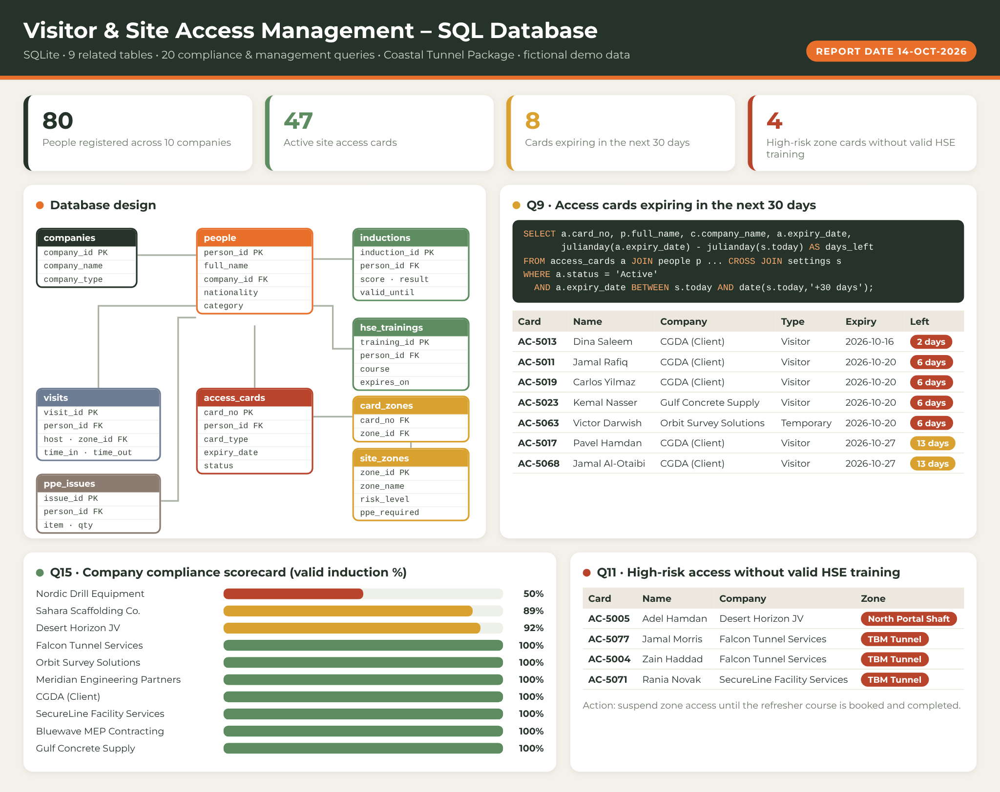

# 🦺 Visitor & Site Access Management – SQL Database

A **SQLite database** for the site gate and HSE desk of a mega construction project. It tracks every visitor, employee and subcontractor from **induction** and **HSE training** to **access cards**, **zone permissions**, **PPE issue** and **daily visits**, and answers the compliance questions security and HSE ask every morning.

> ⚠️ **All data is fictional.** Companies, people, card numbers and dates are demo data. Reporting date is fixed at 14-Oct-2026 through a `settings` table so results are repeatable.

## 📂 Files
| File | Description |
|---|---|
| `01_schema_and_data.sql` | Creates 9 tables (keys, CHECK rules, indexes) and loads the demo data |
| `02_report_queries.sql` | 20 queries from basic to advanced, each with a comment |
| `Visitor_Access.db` | Ready-made SQLite database (open in DB Browser for SQLite) |
| `Visitor_Site_Access_SQL.pdf` | One-page report |
| `Visitor_Site_Access_SQL_Preview.png` | Report preview |

## 🧱 Database design
`companies` → `people` → `inductions`, `hse_trainings`, `access_cards` → `card_zones` ← `site_zones`, plus `ppe_issues` and `visits`

## 🔎 Highlight queries
| # | Report |
|---|---|
| Q3 | Who is on site right now |
| Q9 | Active access cards expiring in the next 30 days |
| Q10 | People with no passed induction |
| Q11 | High-risk zone cards held by people without valid HSE training |
| Q12 | HSE trainings due for refresher in 60 days |
| Q13 | Visits into a zone the visitor's card does not open |
| Q14 | Visits made on an expired card |
| Q15 | Company compliance scorecard |
| Q18 | Running total of cards issued (window function) |
| Q20 | `v_access_compliance` view: gate status for every person |

## ⚙️ SQL concepts used
`JOIN` / `LEFT JOIN` · `GROUP BY` · `NOT EXISTS` · `CTE (WITH)` · `CASE` · window functions · date arithmetic with `julianday()` and `date()` · `VIEW` · `UPDATE` · constraints and indexes

## ▶️ How to run
1. Open **DB Browser for SQLite** (free) and open `Visitor_Access.db`, **or** run `01_schema_and_data.sql` in any SQLite tool.
2. Open `02_report_queries.sql` and run the queries one by one.

## 🛠️ Skills shown
SQL reporting · Relational database design · HSE & site access compliance · Visitor management · Security coordination
