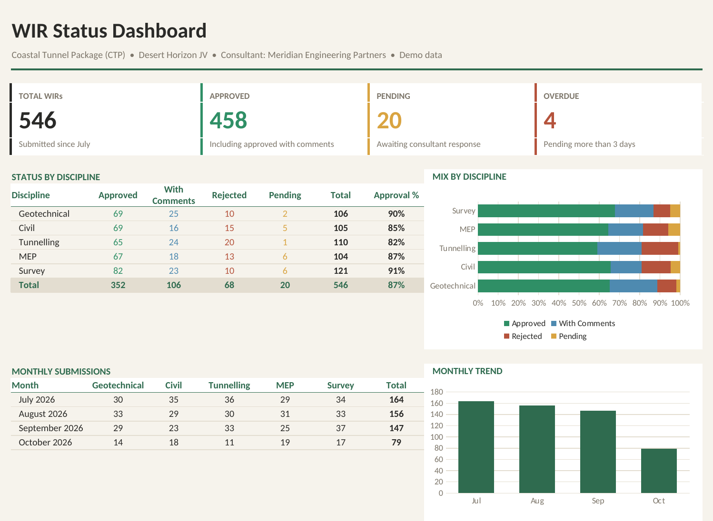

# 🔍 WIR Inspection Tracker

A daily tracker for **Work Inspection Requests (WIRs)** on a construction project – every request from submission to the consultant's response, with live status by discipline and alerts for anything overdue.

## 🎯 Business Problem
Site teams raise dozens of WIRs every day across several disciplines. Without one register, pending inspections are missed, rejected work is not re-inspected on time, and management has no daily view of progress.

## ✅ Solution
| Sheet | What it does |
|---|---|
| **Dashboard** | KPI cards (total, approved, pending, overdue > 3 days), status by discipline with approval %, monthly submission trend and charts |
| **WIR Register** | 546 WIRs with number, date, discipline, activity, chainage, inspection date, consultant inspector, status, response date and days open |
| **Daily Log** | Submissions per discipline per working day (Friday off) – counted automatically from the register |

## ⚙️ Key Features
- **Days Open** calculated automatically; pending WIRs older than 3 days turn **red**
- Colour-coded status: Approved, Approved with Comments, Rejected, Pending
- Dropdown status validation and filters on every column
- Approval % per discipline and charts that update when new WIRs are added

## 🛠️ Tools
Microsoft Excel • COUNTIFS / EOMONTH / TODAY formulas • Conditional Formatting • Data Validation • Excel Charts

## 📥 How to Use
1. Download **WIR_Inspection_Tracker.xlsx**
2. Add new WIRs at the bottom of **WIR Register** and update the status when the consultant responds
3. The **Dashboard** and **Daily Log** update automatically

📄 A one-page PDF of the dashboard is included: **WIR_Inspection_Tracker.pdf**

> 🛡️ All project names, WIR numbers, consultants, inspectors and locations are fictional demo data.
